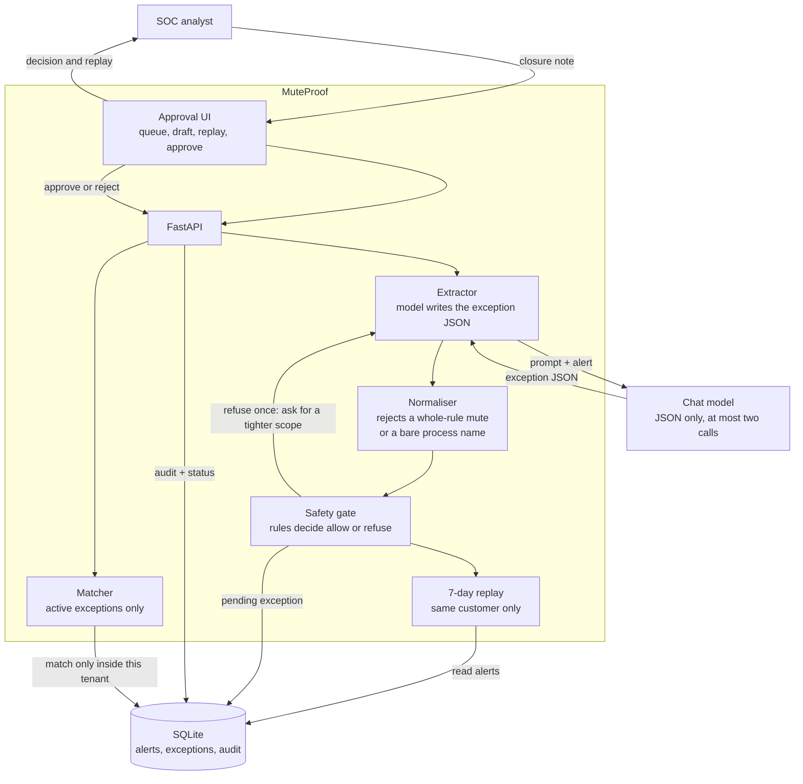

# MuteProof

Turn an analyst’s closure note into a small, temporary mute. Refuse the mute when it would hide a real attack.

CyberForge 2026 · Mitigata · idea submission by 18 Oct, build on 31 Oct in Bengaluru. Team of 2.

This document is the shared plan. The slide outline at the bottom maps one-to-one onto a submission deck.

---

## One sentence

After an analyst closes a noisy alert, MuteProof drafts a scoped, expiring exception for that customer only, shows what the last seven days of alerts would have hidden, and blocks the draft if a high-risk attack sits inside that scope. A human approves it. Nothing is silenced until they do.

## Who it is for

The SOC analyst who closes the same benign alert every shift, and the detection engineer who has to defend every mute in a review. The customer is a mid-sized organisation on a multi-tenant SOC. Mitigata’s book is 1,000+ organisations and a million incidents triaged in the past year. MuteProof sits after that triage.

Gordon already decides which alert deserves a human, and it learns from analyst feedback. MuteProof is the control on what happens next: the closure becomes a rule a person can read, expire, and audit. It does not replace triage.

---

## Problem

A scanner, a backup agent, or an admin jump host fires the same detection every day. The analyst closes it with one line: “Qualys scan window” or “known IT automation.” The line stays in the ticket. The next shift investigates the same pattern again.

One pattern is enough to price the waste. Thirty alerts a day, about two minutes each, is roughly an hour a day. That is on the order of 250 analyst-hours a year for a single pattern at a single customer. The same few noise classes repeat across the book.

The shortcut people reach for is a wide mute. “Ignore PowerShell on this subnet” also matches how ransomware stages. That mute has no owner, no expiry, and no record of what else it would have hidden. In a multi-tenant SOC, one customer’s “this is our scanner” must never silence another customer.

## Solution

MuteProof reads the closed alert and the analyst’s sentence and proposes one exception:

- which detection
- which host, account, or process
- which hours
- which customer
- who owns it
- when it expires

A safety check replays that exception against the last seven days of alerts for that same customer. If the mute would also have hidden a high-risk pattern, MuteProof refuses it and proposes a tighter scope. The analyst approves or rejects. Approved exceptions expire. Renewal means running the replay again.

## Where the AI is

The model does one job: read a loose sentence plus the alert fields and emit a structured exception. “Qualys scan, ignore it” becomes “this scanner range, 01:00–04:00, this customer, 14 days.”

If the draft is too wide, the model also suggests a narrower one. “Ignore PowerShell on the subnet” can come back as “this IT automation account, this signed binary, 7 days.”

The safety decision is not left to the model. Fixed rules plus the seven-day replay allow or refuse the draft. A human approves before anything is suppressed.

| Step | Who decides | Output |
| --- | --- | --- |
| Read the closure note | Model | Exception JSON |
| Suggest a tighter scope when the first draft is broad | Model | Second exception JSON |
| Refuse if a high-risk alert sits in scope | Rules + replay | Allow or refuse, with the alerts that matched |
| Silence future alerts | Human | Approved exception with owner and expiry |

---

## What the demo must show

Six closed alerts, one mock customer, one second customer used only to prove isolation.

1. Note “Qualys scan, 01:00–04:00” becomes a 14-day exception for that scanner range and those hours. Replay shows only scanner alerts.
2. Note “Ignore PowerShell on the subnet” is refused. Replay shows a confirmed remote-execution alert inside that scope. The alternative is the IT automation account, the signed admin binary, and a 7-day expiry.
3. The scanner exception does not exist for the second customer.

If those three scenes work on a laptop, the idea is demonstrated.

---

## Technical design

### High-level design

The analyst never talks to the model. The UI talks to the API. The model only drafts JSON. The safety gate and the replay decide whether that draft may be approved. SQLite holds alerts, exceptions, and the audit log for each customer separately.



What each box owns:

| Box | Owns | Does not own |
| --- | --- | --- |
| Approval UI | Customer switcher, the note, the draft, the replay, approve and reject | Any allow or refuse decision |
| FastAPI | One closure request, schema checks, status changes | Alert matching rules |
| Extractor | Turning the note into exception JSON | Whether that JSON is safe |
| Normaliser | Dropping a whole-rule mute or a filename with no hash or publisher | Replay |
| Safety gate | Allow for approval, or refuse | Writing free-text explanations as the decision |
| Replay | Alerts from the last seven days inside this customer that the draft would hide | Other customers |
| Matcher | Applying an active, unexpired exception to later alerts | Creating exceptions |
| Chat model | The draft, and one narrower draft if the gate refuses | Approval, expiry, tenant isolation |
| SQLite | Alerts, exceptions, audit rows | Cross-customer queries. Every read filters on `tenant_id` |

### Flow

```text
Analyst closes alert + writes a note
        |
        v
POST /api/closures
        |
        v
Extractor (model)  -->  ExceptionDraft JSON
        |
        v
Normaliser          -->  drop drafts that mute a whole rule
        |                  or a bare process name
        v
Safety gate
  - scope rules
  - 7-day replay, same tenant only
        |
        +-- refuse --> narrower draft from the model, then gate again (once)
        |
        +-- pass --> pending exception
                         |
                         v
                  Analyst approves or rejects
                         |
                         v
                  Audit log. Active until expiry.
                  Matcher uses it only inside that tenant.
```

The model is called at most twice per closure: once for the draft, once if the gate asks for a tighter scope. A third call is not part of the hackathon build.

### Components

| Piece | Responsibility | Hackathon implementation |
| --- | --- | --- |
| Seed store | Alerts, closures, exceptions, audit | SQLite |
| Extractor | Note + alert → ExceptionDraft | One chat completion, JSON schema |
| Normaliser | Reject illegal shapes before the gate | Pure Python |
| Replay | Alerts in the last 7 days that the draft would match | SQL filtered by `tenant_id` |
| Safety gate | Allow or refuse using replay + tactic rules | Pure Python, no model |
| API | Closures, decisions, approve, reject | FastAPI |
| UI | Queue, draft, replay, approve | React |

### Matching an alert to an exception

An active exception matches an alert only when every bound field matches.

- `tenant_id` is always required. A query without it returns nothing.
- `detection_name` must match exactly.
- The single entity must match: host, user, source CIDR, or process identity.
- If a time window is set, the alert timestamp must fall inside it.
- `status` must be `active` and `expires_at` must be in the future.

Process identity is a SHA-256 or a publisher plus filename. A filename alone never matches.

### Scope rules (the gate)

These are code, not prompt text.

1. Exactly one `tenant_id`, one `detection_name`, one entity.
2. CIDR no wider than /24, and only on the vulnerability-scanner detection, and only with a window of at most 4 hours.
3. A process match without a hash or a publisher is refused.
4. If any replayed alert in scope has `disposition = malicious`, refuse.
5. If any replayed alert in scope has a tactic in the high-risk set, refuse.
6. Scanner-class exceptions expire in at most 14 days. Anything that touches execution expires in at most 7 days.
7. The gate runs the narrower draft at most once. If that also fails, the UI shows refuse and the replay. No further model calls.

High-risk tactics for the demo, stored as tags on the seed alerts:

| Tag | Why a broad mute is unsafe |
| --- | --- |
| `credential_access` | Dumping or stealing credentials |
| `suspicious_execution` | Script or binary running outside the allowed identity |
| `lateral_movement` | Spreading to another host |
| `ransomware_staging` | Encryption or shadow-copy tampering |

A scanner alert tagged `benign` inside a scanner window does not trip the gate. A PowerShell alert tagged `suspicious_execution` and `malicious` does.

### Data model

```text
tenants
  id, name

alerts
  id, tenant_id, detection_name, severity, seen_at
  host, user_name, process_name, process_sha256, publisher
  src_ip, tactic            -- nullable tactic tag
  disposition               -- open | benign | malicious
  closure_note, closed_by   -- nullable until closed

exceptions
  id, tenant_id, detection_name
  entity_type               -- host | user | cidr | process
  entity_value
  window_start_hour         -- nullable, 0-23
  window_end_hour           -- nullable
  owner, source_note, source_alert_id
  status                    -- pending | active | refused | rejected | expired
  expires_at, created_at
  refusal_reason            -- nullable

audit
  id, exception_id, tenant_id, action, actor, detail, at
  -- action: drafted | refused | narrowed | approved | rejected | expired
```

`entity_type = process` stores `sha256:<hex>` or `publisher:<name>|file:<name>`.

### Exception JSON the model must return

The API rejects any response that fails this shape. The model does not get a second try on a schema failure; the UI shows “could not draft” and the analyst keeps the ticket.

```json
{
  "tenant_id": "cust-a",
  "detection_name": "vuln-scanner-traffic",
  "entity_type": "cidr",
  "entity_value": "203.0.113.0/24",
  "window_start_hour": 1,
  "window_end_hour": 4,
  "suggested_owner": "analyst@soc",
  "expiry_days": 14,
  "source_note": "Qualys scan, 01:00-04:00"
}
```

`entity_type` is one of `host`, `user`, `cidr`, `process`. `expiry_days` is an integer. Hours are integers 0–23 or null when the note has no window.

System prompt, kept short on purpose:

```text
You convert a SOC closure note into one exception JSON object.
Use only facts present in the note and the alert. Do not invent hosts, users, or hashes.
Bind exactly one entity. Never mute an entire detection.
A process exception needs a sha256 or a publisher. A filename alone is invalid.
Prefer the smallest scope the note supports.
Return JSON only, matching the schema.
```

The narrower-scope prompt adds the refusal reason and the malicious alert ids, and asks for a smaller entity. Same schema.

### API

| Method | Path | Behaviour |
| --- | --- | --- |
| `GET` | `/api/tenants/{tenant_id}/alerts` | Open and recently closed alerts for that tenant |
| `POST` | `/api/closures` | Body: `alert_id`, `note`, `analyst`. Runs extract → gate. Returns the draft, decision, replay, and optional narrower draft |
| `POST` | `/api/exceptions/{id}/approve` | Pending → active. Writes audit. 409 if refused or expired |
| `POST` | `/api/exceptions/{id}/reject` | Pending → rejected. Writes audit |
| `GET` | `/api/exceptions?tenant_id=` | List for one tenant. Required query |
| `GET` | `/api/exceptions/{id}/replay` | The seven-day matches used by the gate |

`POST /api/closures` response:

```json
{
  "decision": "refuse",
  "draft": {},
  "replay": [],
  "refusal_reason": "scope contains a malicious suspicious_execution alert",
  "narrower_draft": {},
  "narrower_decision": "allow_for_approval"
}
```

`decision` is `allow_for_approval` or `refuse`.

### Seed alerts

Customer A, `cust-a`. Times are the demo clock, all inside the last seven days.

| Id | Detection | Entity | Tactic | Disposition | Note the demo types |
| --- | --- | --- | --- | --- | --- |
| a1 | `vuln-scanner-traffic` | `203.0.113.10` | — | benign | Qualys scan, 01:00–04:00 |
| a2–a4 | same | `.11 .12 .13` in `203.0.113.0/24`, inside 01:00–04:00 | — | benign | already closed, used by replay |
| a5 | `script-execution` | host `fin-01`, `powershell.exe`, no publisher | `suspicious_execution` | malicious | Ignore PowerShell on the subnet |
| a6 | `script-execution` | user `svc-it`, publisher `Contoso`, file `Invoke-Maintenance.exe` | — | benign | the narrower alternative points here |

Customer B, `cust-b`, has the same scanner detection on a different range. After A’s scanner exception is approved, B’s screen shows no active exception.

---

## Tech

| Layer | Choice | Why |
| --- | --- | --- |
| API | Python 3.11, FastAPI, Pydantic | Schema validation is the product. Fast to show. |
| DB | SQLite | One file, no setup on hackathon wifi |
| UI | React + Vite | One approval screen, no server-side rendering |
| Model | Any chat API that returns JSON. Gemini or OpenAI, behind one function | Swap keys without touching the gate |
| Tests | pytest on the gate and the matcher | The refusal cases are the demo. They should fail in CI-style locally before the laptop demo |

No login, no cloud deploy, no streaming. The UI talks to `localhost`.

Repository layout to create on the day:

```text
muteproof/
  backend/
    app.py              # routes
    extractor.py        # model call + schema check
    gate.py             # rules + replay
    matcher.py
    db.py
    seed.py
    prompts.py
    tests/test_gate.py
  frontend/
    src/App.jsx         # queue, draft, replay, approve
  README.md             # this file
```

### Screen

One page, three columns.

1. **Queue.** Customer switcher (A / B). Closed alerts with their notes.
2. **Draft.** The sentence, the JSON in plain labels (not raw JSON as the only view), decision badge, expiry, owner.
3. **Replay.** Each matched alert, benign or malicious. Approve is enabled only when `decision = allow_for_approval`. Refuse shows the reason and the narrower draft, with its own approve button if that one passed the gate.

Customer B is the same page with a different `tenant_id`. Empty exception list is the isolation proof.

---

## Build plan

Rule reminder: the hackathon asks for work created for this event. Use the days before 31 Oct to agree this design and the slides. Write the code on the day.

Two people. Swap ownership if one of you is faster in Python.

| Block | Hours | Person 1 | Person 2 |
| --- | --- | --- | --- |
| 1 | 0–2 | SQLite schema, seed, matcher | Vite app shell, customer switcher, alert list |
| 2 | 2–5 | Gate rules + pytest for the three demo scenes | Approval panel bound to mocked JSON |
| 3 | 5–8 | Extractor + `POST /closures` | Wire the panel to the API |
| 4 | 8–11 | Replay endpoint, audit, expiry check | Replay list, disabled approve on refuse |
| 5 | 11–13 | Run the three scenes against the seed | Fix the path the judges will click |
| 6 | last hour | Freeze seed. Rehearse the spoken demo twice | Same |

Cut list if time slips, in this order: expiry job (check `expires_at` on read instead), nicer styling, a second model provider. Do not cut the refuse scene or the second customer.

Tests that must pass before the demo:

- Scanner note → `allow_for_approval`, replay has no malicious row.
- PowerShell-on-subnet note → `refuse`, replay contains alert `a5`.
- Narrower IT-automation draft → `allow_for_approval`.
- Active scanner exception for `cust-a` does not match a `cust-b` alert.
- Process name `powershell.exe` with no hash and no publisher is refused by the normaliser.

## Risks

| Risk | What we do |
| --- | --- |
| Model returns prose or invented hosts | Pydantic rejects it. UI says the draft failed. Seed notes are written so the happy path is easy. |
| Judges ask “doesn’t triage already learn?” | Gordon decides what reaches a human. MuteProof is the readable, expiring, per-customer rule after the close, with a refusal when the rule would hide an attack. |
| Wifi blocks the model API | Cache the two successful JSON drafts for the rehearsed notes. The gate still runs live on those drafts. Say that the cache is the fallback. |
| Scope creep into auto-closing alerts | Out of scope. MuteProof never closes or suppresses without `approve`. |

## Out of scope

- Connecting to a real SIEM or EDR
- Training a model
- Cross-customer learning
- Automatic renewal
- Muting a whole detection rule

---

## Slide outline

Aim for 8 slides. Titles are the slide titles. Body is what to say, not a paragraph to paste onto the slide.

**1. MuteProof**
An analyst writes “this is our scanner.” We turn that into a small, temporary mute, and we block it when it would hide an attack.

**2. The queue fills up after the close**
Same scanner alert, every day. The note dies in the ticket. Next shift investigates it again. One pattern, 30 times a day, about two minutes each: roughly an hour a day, about 250 analyst-hours a year, one customer.

**3. The dangerous shortcut**
“Ignore PowerShell on this subnet” also matches ransomware staging. No owner, no expiry, no record of what else went quiet. One customer’s lesson must not silence another customer.

**4. What MuteProof does**
Drafts one exception: one detection, one entity, one time window, one customer, an owner, an expiry. Replays the last seven days. Refuses if a high-risk alert is inside. A person approves.

**5. Where the AI is**
The model reads the sentence and fills the exception. Rules and the replay decide allow or refuse. The human turns it on.

**6. Three scenes we will show**
Scanner note → 14-day mute, replay is clean. Subnet PowerShell note → refused, because a confirmed remote-execution alert is in scope; tighter alternative offered. Second customer → that scanner mute is absent.

**7. Impact**
Hours back to analysts on repeat noise. The attack stays visible. Every approve, refuse, and expiry is an audit line a detection engineer can defend.

**8. What we are building on 31 Oct**
A local web app and API. Seeded alerts. Structured draft, safety gate, replay, approval. Model writes the exception. Rules decide if it may exist.
